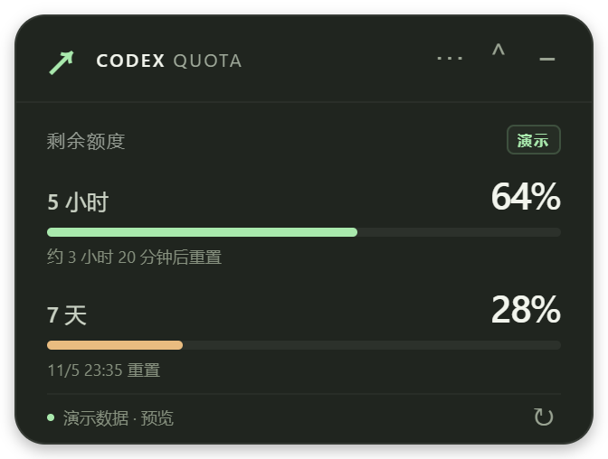

# Codex Quota · 额度悬浮窗

把 Codex 的 **5 小时 / 每周剩余额度**放到屏幕角落。可拖动、置顶、折叠与隐藏，支持 Windows 和 macOS。

这是社区开发的个人插件，使用 Codex 支持的插件格式分发。它包含安装/管理 skill 和一个 Electron 桌面程序，不代表 OpenAI 官方出品。插件安装后运行本地悬浮窗，不修改 Codex 客户端。




## 直接发给 Codex

复制下面这段到 Codex：

```text
请帮我安装并启动这个 Codex 额度悬浮窗：
https://github.com/fangege520/codex-quota
请先读取仓库的 INSTALL.md，按我当前的 Windows 或 macOS 环境完成安装、额度读取验证和启动。
```

当前仓库保持私有：朋友需要被授予仓库读取权限并完成 GitHub 登录，才能通过链接下载。之后仓库公开时，上面同一段提示词可以继续用。安装依赖与首次下载 Electron 需要网络；首次账户登录和系统授权仍需本人完成。

## 功能

- 屏幕右上角首次显示，可拖动到任意显示器，自动记住位置。
- 同时显示 5 小时与每周的**剩余**百分比、进度条和重置时间。
- 保持置顶、折叠成小条、隐藏到 Windows 托盘 / macOS 菜单栏。
- Ctrl/⌘+Shift+Q 切换显示；快捷键被其他软件占用时可使用托盘菜单。
- 默认每 60 秒刷新，可选 30/120 秒；失败自动重试并标记上次数据。
- 中文 / English、透明度、恢复位置、手动选择 Codex 可执行文件。
- 打包版支持登录时启动；源码版不会写入开机启动配置。

## 安装原理

插件源位于 `.agents/plugins/marketplace.json`，插件位于 `plugins/codex-quota/`。插件同时提供 portable `plugin.json` 与 `.codex-plugin/plugin.json` 兼容入口。

`node install.cjs` 会调用官方 Codex CLI 注册本地插件源并安装插件，在实际安装目录下载运行依赖、验证额度并启动。现有插件配置交给 CLI 合并。安装后可能需要重启 Codex，然后在新聊天选择本插件或运行设置向导；个人/本地来源的具体显示位置随客户端版本变化。

也可以通过官方命令直接添加 GitHub 插件源，再在新聊天请求启动：

```sh
codex plugin marketplace add https://github.com/fangege520/codex-quota
codex plugin add codex-quota@codex-quota-marketplace
```

直接添加插件源时，安装/启动 skill 会检查依赖并完成桌面程序设置。

## 本地开发

需要 Node.js ≥22.12、npm、官方 Codex CLI，以及 CLI 中有效的 ChatGPT 账户登录。macOS 包括 Apple Silicon 和 Intel；Windows 包括 x64 源码运行与打包目标。

```sh
cd plugins/codex-quota
npm ci
npm test
npm run check
npm start
```

源码管理命令：

```sh
node scripts/manage.cjs start
node scripts/manage.cjs show
node scripts/manage.cjs hide
node scripts/manage.cjs stop
```

悬浮窗不要求 Codex 聊天持续运行。退出悬浮窗会停止轮询并关闭它自己的 app-server 子进程。

## 额度与隐私

程序启动本地 `codex app-server`，只调用初始化、`account/read`、`account/rateLimits/read`。它不调用 `thread/start` 或 `turn/start`，不会为了轮询额度发起模型推理。

它依赖 Codex 自己管理登录状态，不读取或上传认证文件；没有额外的遥测、云端代理或上传接口。窗口中的百分比来自服务器，不按任务数估算。服务器返回的 `usedPercent` 会转换为 `100 - usedPercent`。未返回的数据显示为不可用；经过重置时间也不会擅自显示 100%。

桌面端和独立 CLI 的登录账户、`CODEX_HOME` 可能不同；如果额度不一致，请检查本机所选 CLI 的登录账户。需要时可通过菜单选择 CLI，或设置 `CODEX_QUOTA_CODEX_BIN` 为原生可执行文件路径。

窗口位置、透明度等设置仅保存在本机的 `codex-quota/settings.json` 中。Windows 位于 `%APPDATA%`，macOS 位于 `~/Library/Application Support`。关闭窗口默认隐藏到托盘，彻底退出请使用菜单。卸载插件前先退出悬浮窗；已安装的独立打包应用需另外卸载。

## 测试与发布

```sh
npm run smoke   # 隔离配置、演示数据；验证原生窗口行为并生成截图
cd ../..       # 以下打包命令在仓库根目录执行
npm ci         # 只在开发打包时下载构建工具
npm run pack    # 为当前平台生成未安装的应用目录
npm run dist    # 生成当前平台安装包/压缩包
```

GitHub Actions 在 Windows、Mac Apple Silicon、Mac Intel 上运行测试与窗口检查。发布流程为三个目标生成下载文件；推送 `v*` 标签后会创建**草稿 Release**，供检查后手动发布。

此仓库未配置代码签名证书或 Apple 公证。源码安装不需要绕过系统安全设置；预编译包正式公开前应完成对应平台签名/公证或明确说明分发状态。源码可运行和工作流已编写，不等于所有平台均已通过实测；以对应 CI 结果为准。

## 官方参考

- [Codex 插件打包与个人插件源](https://developers.openai.com/plugins/build/plugins)
- [Codex App Server：账户额度](https://learn.chatgpt.com/docs/app-server#6-rate-limits-chatgpt)
- [插件目录与个人插件](https://learn.chatgpt.com/docs/plugins)

MIT License.
