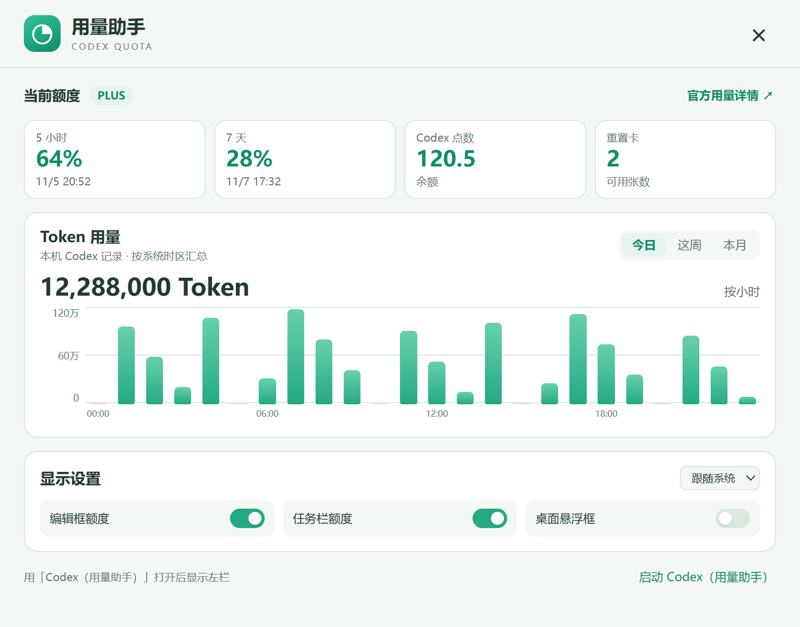
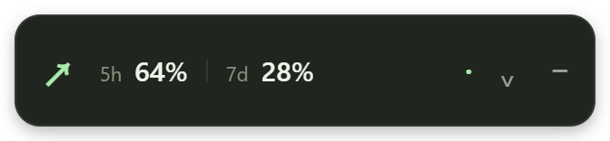

# Codex Quota · 用量助手

在 Windows 和 macOS 上查看 Codex 的 5 小时和每周剩余额度。

## 界面

- **任务栏和菜单栏**显示剩余额度。Windows 在任务栏有空位时显示，macOS 在顶部菜单栏显示。
- **Codex 左栏**显示额度、重置时间、点数、重置卡和套餐。把鼠标移到会话上可查看会话 Token；每轮用时旁可查看本轮 Token、模型和推理强度。
- **用量助手设置**提供今日、本周、本月的 Token 图表，可分别开启左栏、编辑框额度、系统栏和桌面悬浮框。



## 使用

| 平台 | 启动入口 | 查看额度 |
| --- | --- | --- |
| Windows | 开始菜单的 **Codex Quota**。源码安装使用 **Codex（用量助手）** | 任务栏额度或托盘图标 |
| macOS | Finder「应用程序」中的 **Codex Quota.app**。源码安装位于 `~/Applications` | 顶部菜单栏 |

要显示 Codex 左栏，请等当前任务完成，正常退出 Codex，再从助手设置点击 **启动 Codex（用量助手）**。点击左栏齿轮或右键点击系统栏组件可打开设置。按 `Ctrl+Shift+Q`（Windows）或 `⌘+Shift+Q`（macOS）可切换桌面悬浮框。



## 安装

### 安装包下载

- [Windows x64 · 下载 `.exe`](https://github.com/fangege520/codex-quota/releases/download/v0.4.2/Codex-Quota-0.4.2-win-x64.exe)
- [Mac Apple 芯片 · 下载 `.dmg`](https://github.com/fangege520/codex-quota/releases/download/v0.4.2/Codex-Quota-0.4.2-mac-arm64.dmg)
- [Mac Intel · 下载 `.dmg`](https://github.com/fangege520/codex-quota/releases/download/v0.4.2/Codex-Quota-0.4.2-mac-x64.dmg)

### 复制给 Codex 执行

在 Windows 或 macOS 的 Codex 桌面端粘贴这段文字。

```text
请读取 https://github.com/fangege520/codex-quota/blob/main/INSTALL.md，识别本机的系统和处理器架构，下载对应的 Codex Quota 成品安装包，安装并打开用量助手，验证 Windows 任务栏或 macOS 菜单栏能否显示额度。遇到系统确认、授权或登录时，请让我操作。
```

手动安装和源码导入见 [安装说明](INSTALL.md)。
