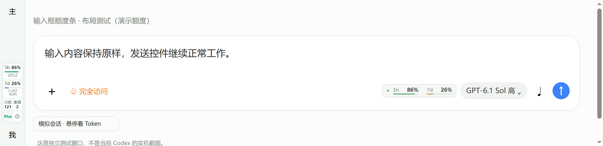

# Codex Quota · 额度悬浮窗

把 Codex 的 **5 小时 / 每周剩余额度**放到 Windows 任务栏、macOS 菜单栏，或屏幕角落。可拖动、置顶、折叠与隐藏。

这是社区开发的个人插件，使用 Codex 支持的插件格式分发。它包含安装/管理 skill 和一个 Electron 桌面程序，不代表 OpenAI 官方出品。插件安装后运行本地悬浮窗，不修改 Codex 客户端。


## 0.3 系统栏与新版面板

- **Windows**：在水平任务栏的空闲位置显示两个额度圆环和百分比，跟随屏幕缩放、多屏任务栏和图标位置变化。空位较窄时自动切换为上下两行的小组件，避让电量、天气等工具栏；没有安全空位时隐藏。悬停显示详情，点击固定打开，再点击或点击其他窗口收起；右键打开设置。
- **macOS**：顶部菜单栏直接显示 `5h 64%  7d 28%`，点击打开详情，右键打开设置。
- **新版面板**：圆环卡片、大百分比、重置时间与同步状态；可选跟随系统、浅色或深色外观。刷新失败时明确标记缓存数据。
- 原有桌面浮窗和输入框额度条可继续单独开启。系统栏默认开启；在右键菜单关闭，或运行 `node scripts/manage.cjs system-bar-off`。`show` 显示可拖动浮窗，`hide` 只隐藏详情浮窗。


Windows 使用独立窗口覆盖任务栏空位，不注入或修改 Explorer。无安全空位、自动隐藏任务栏收起、全屏应用或无法读取占用范围时隐藏组件，仍可从托盘打开详情。标准 Windows 11 水平任务栏已在开发机验证；竖直、第三方任务栏不支持。macOS 的自动检查覆盖菜单栏文字与弹出面板，具体菜单栏布局仍需 Mac 实机确认。

## 0.4 左栏用量、设置与启动

**Windows 首次使用**：等当前任务完成并完全退出普通 Codex，从桌面或开始菜单打开 **Codex（用量助手）**。这个入口同时启动助手并连接 Codex 左栏。macOS 可用托盘里的 **启动 Codex（用量助手）**。

- 左下导航栏显示 5 小时/7 天额度、进度和重置时间，另有 Codex 点数余额、重置卡张数、会员套餐和齿轮。悬停查看额度详情或可用重置卡的到期时间。空位不足时保留齿轮；没有安全空位时可从托盘打开设置。
- 点击点数/重置卡跳到 Codex 用量设置。详情里的使用按钮打开 [官方用量页面](https://chatgpt.com/settings/usage)，购买和兑换由用户自行完成。
- 悬停会话行查看 Token。优先使用本机记录；可用时回退到明确标注的服务端估算。
- 齿轮打开居中设置，包含今日逐小时、本周逐日、本月逐日柱状图，及编辑框、任务栏/菜单栏、浮窗三个开关。编辑框额度条没有设置按钮。




原厂图标不会启动页面连接。新版启动入口通过 Windows 系统应用激活接口传入本地连接参数，每次重新查找当前安装版本，不会强制结束现有 Codex，也不会替换原厂图标。

首次启动会把程序和 Electron 复制到本机 `codex-quota/runtime/<版本>` 持久目录，避免 Codex 启动时重建插件缓存而丢失运行依赖。该目录与设置一样位于 Windows `%APPDATA%` 或 macOS `~/Library/Application Support`。

也可以在插件安装目录执行：

```sh
node scripts/manage.cjs settings
node scripts/manage.cjs create-launcher  # Windows：创建或刷新快捷方式
node scripts/manage.cjs composer-status
# 完全退出 Codex 后，在外部终端执行：
node scripts/manage.cjs launch-codex
```

- 插入独立的 Shadow DOM 节点，不读取/写入输入内容，不移动 React 管理的按钮。
- 页面刷新或输入框重新渲染后自动挂载；窄窗口空间不足时隐藏，避免覆盖原有控件。
- 只处理 Codex 本机工作区页面；排除网页标签、桌面宠物和辅助浮窗。
- 关闭编辑框显示仍保留左栏。退出用量助手会移除自身组件；要关闭调试端口，请完全退出 Codex 后用原厂图标启动。
- 依赖客户端内部布局标记，不属于官方 UI 扩展 API。客户端升级后可能需要适配；跨平台自动检查使用独立测试窗口，不能替代各版本客户端的实机验证。
- 本机调试端口具有页面控制能力，只绑定回环地址；额度条只接收百分比和重置时间等展示数据。

## 直接发给 Codex

复制下面这段到 Codex：

```text
请帮我安装并启动这个 Codex 额度悬浮窗：
https://github.com/fangege520/codex-quota
请先读取仓库的 INSTALL.md，按我当前的 Windows 或 macOS 环境完成安装、额度读取验证和启动。
```

当前仓库保持私有：朋友需要被授予仓库读取权限并完成 GitHub 登录，才能通过链接下载。之后仓库公开时，上面同一段提示词可以继续用。安装依赖与首次下载 Electron 需要网络；首次账户登录和系统授权仍需本人完成。

## 功能

- 屏幕右上角首次显示，可拖动到任意显示器，自动记住位置。
- 同时显示 5 小时与每周的**剩余**百分比、进度条和重置时间。
- 保持置顶、折叠成小条、隐藏到 Windows 托盘 / macOS 菜单栏。
- Ctrl/⌘+Shift+Q 切换显示；快捷键被其他软件占用时可使用托盘菜单。
- 默认每 60 秒刷新，可选 30/120 秒；失败自动重试并标记上次数据。
- 中文 / English、透明度、恢复位置、手动选择 Codex 可执行文件。
- 打包版支持登录时启动；源码版不会写入开机启动配置。

## 安装原理

插件源位于 `.agents/plugins/marketplace.json`，插件位于 `plugins/codex-quota/`。插件同时提供 portable `plugin.json` 与 `.codex-plugin/plugin.json` 兼容入口。

`node install.cjs` 会调用官方 Codex CLI 注册本地插件源并安装插件，在实际安装目录下载运行依赖、验证额度并启动。现有插件配置交给 CLI 合并。安装后可能需要重启 Codex，然后在新聊天选择本插件或运行设置向导；个人/本地来源的具体显示位置随客户端版本变化。

也可以通过官方命令直接添加 GitHub 插件源，再在新聊天请求启动：

```sh
codex plugin marketplace add https://github.com/fangege520/codex-quota
codex plugin add codex-quota@codex-quota-marketplace
```

直接添加插件源时，安装/启动 skill 会检查依赖并完成桌面程序设置。

## 本地开发

需要 Node.js ≥22.12、npm、官方 Codex CLI，以及 CLI 中有效的 ChatGPT 账户登录。macOS 包括 Apple Silicon 和 Intel；Windows 包括 x64 源码运行与打包目标。

```sh
cd plugins/codex-quota
npm ci
npm test
npm run check
npm start
```

源码管理命令：

```sh
node scripts/manage.cjs start
node scripts/manage.cjs show
node scripts/manage.cjs hide
node scripts/manage.cjs stop
```

悬浮窗不要求 Codex 聊天持续运行。退出悬浮窗会停止轮询并关闭它自己的 app-server 子进程。

## 额度与隐私

程序通过本地 `codex app-server` 读取账户、额度、点数和重置卡。缺少本机会话统计时，尝试只读的 `account/usage/read`。它不会为额度或图表发起模型推理，也不会使用重置卡或点数。

图表按系统时区汇总本机日志的 Token 用量事件，不解析对话正文、不上传日志。图表不代表账单或跨设备总量。

它依赖 Codex 自己管理登录状态，不读取或上传认证文件；没有额外的遥测、云端代理或上传接口。窗口中的百分比来自服务器，不按任务数估算。服务器返回的 `usedPercent` 会转换为 `100 - usedPercent`。未返回的数据显示为不可用；经过重置时间也不会擅自显示 100%。

桌面端和独立 CLI 的登录账户、`CODEX_HOME` 可能不同；如果额度不一致，请检查本机所选 CLI 的登录账户。需要时可通过菜单选择 CLI，或设置 `CODEX_QUOTA_CODEX_BIN` 为原生可执行文件路径。

窗口位置、透明度等设置仅保存在本机的 `codex-quota/settings.json` 中。Windows 位于 `%APPDATA%`，macOS 位于 `~/Library/Application Support`。关闭窗口默认隐藏到托盘，彻底退出请使用菜单。卸载插件前先退出悬浮窗；已安装的独立打包应用需另外卸载。

## 测试与发布

```sh
npm run smoke   # 隔离配置、演示数据；验证原生窗口行为并生成截图
npm run test:composer # 真实 CDP 连接独立测试窗口，验证注入、刷新、避让与移除
cd ../..       # 以下打包命令在仓库根目录执行
npm ci         # 只在开发打包时下载构建工具
npm run pack    # 为当前平台生成未安装的应用目录
npm run dist    # 生成当前平台安装包/压缩包
```

GitHub Actions 在 Windows、Mac Apple Silicon、Mac Intel 上运行测试与窗口检查。发布流程为三个目标生成下载文件；推送 `v*` 标签后会创建**草稿 Release**，供检查后手动发布。

此仓库未配置代码签名证书或 Apple 公证。源码安装不需要绕过系统安全设置；预编译包正式公开前应完成对应平台签名/公证或明确说明分发状态。源码可运行和工作流已编写，不等于所有平台均已通过实测；以对应 CI 结果为准。

## 官方参考

- [Codex 插件打包与个人插件源](https://developers.openai.com/plugins/build/plugins)
- [Codex App Server：账户额度](https://learn.chatgpt.com/docs/app-server#6-rate-limits-chatgpt)
- [插件目录与个人插件](https://learn.chatgpt.com/docs/plugins)

MIT License.

任务栏空位定位思路参考 [SaturdayF/codex-quota-bar](https://github.com/SaturdayF/codex-quota-bar)。本项目保留独立的 Electron 实现、数据读取与跨平台插件安装流程。
